# App screenshots

Generated automatically by the **Android CI** workflow (`.github/workflows/mobile-android.yml`)
using [Paparazzi](https://github.com/cashapp/paparazzi) — every borrower-facing screen of the DPC
rendered on a Pixel 5 profile with sample tenant data. Do not edit by hand.

### Enrollment in progress

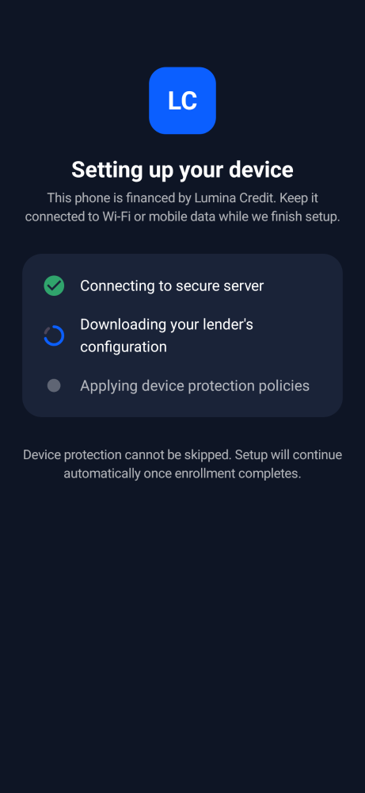

### Enrollment failed

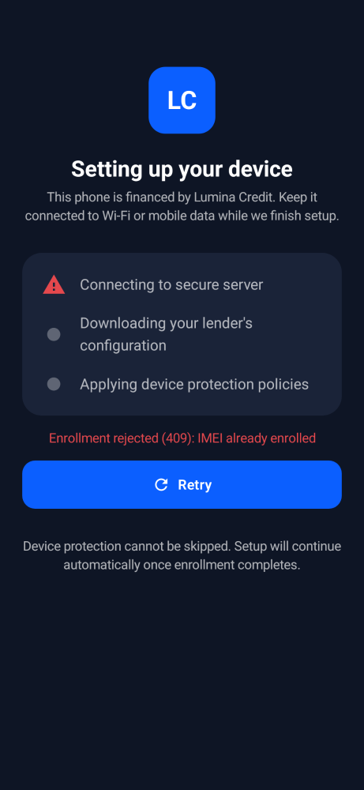

### Home active

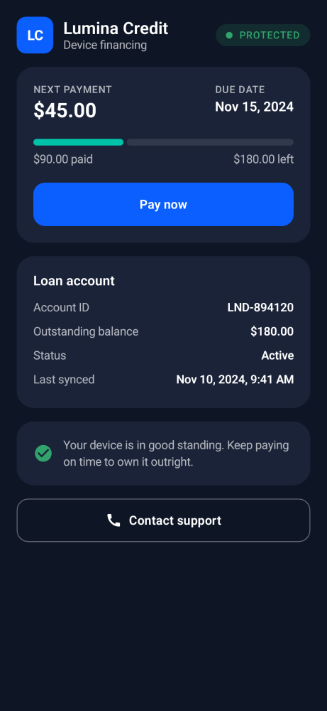

### Home grace warning

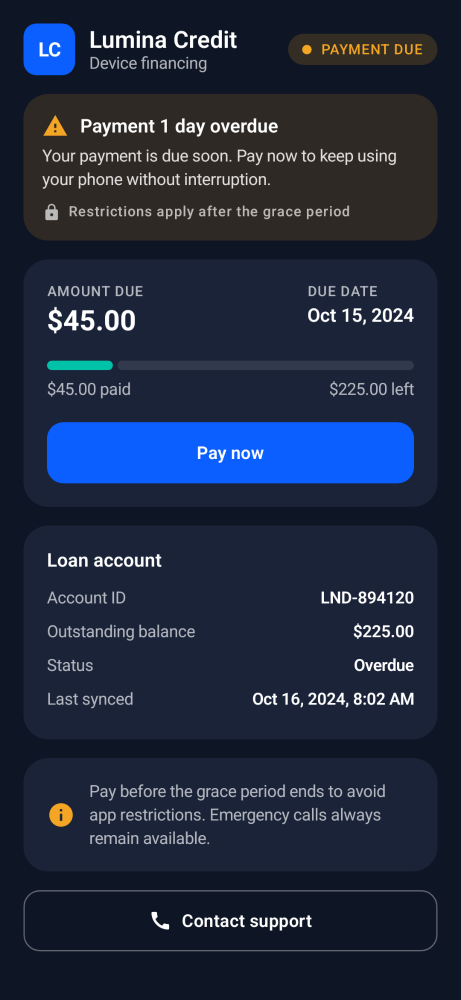

### Soft lock restricted

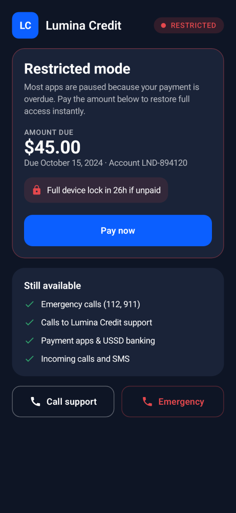

### Hard lock overdue

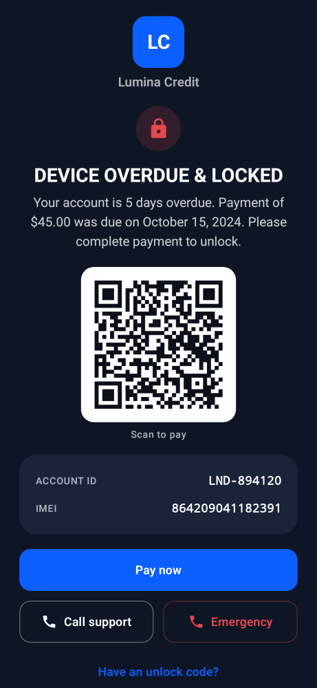

### Hard lock tamper

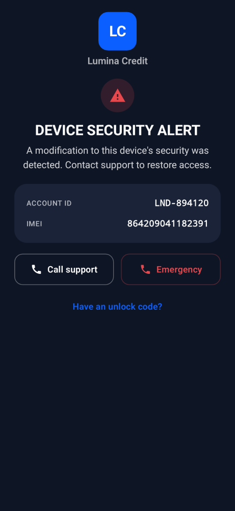

### Offline unlock code

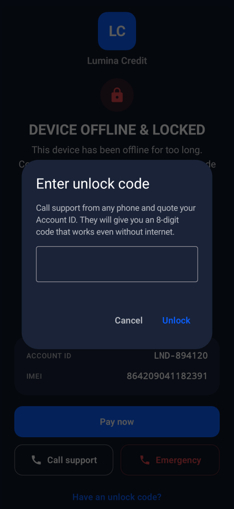

### Payment options

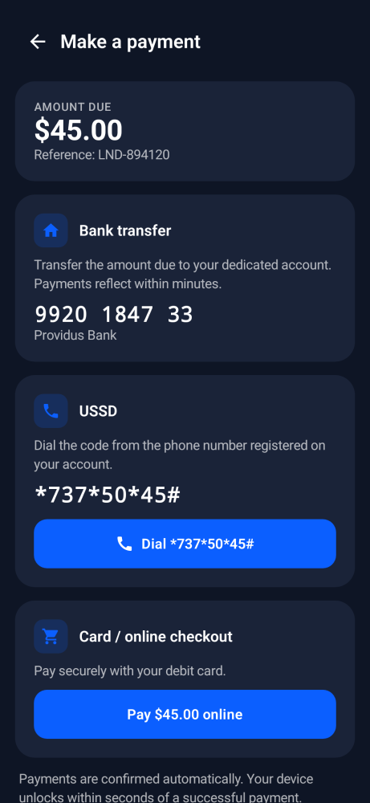

### Support

### Released

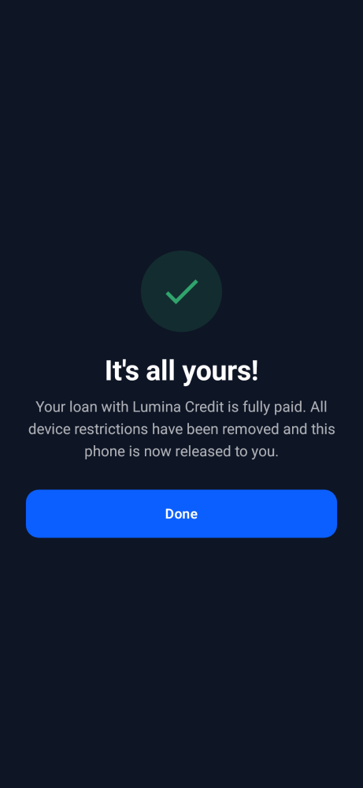

### White label light home

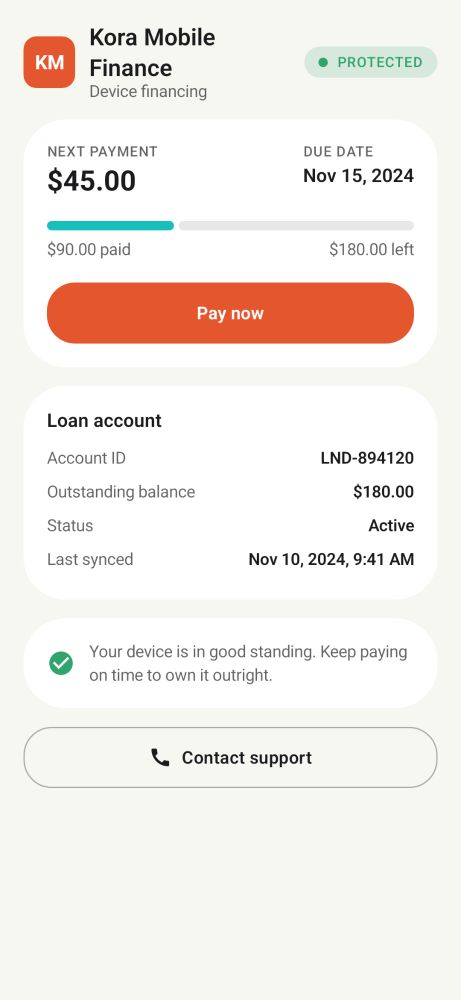

### White label light hard lock

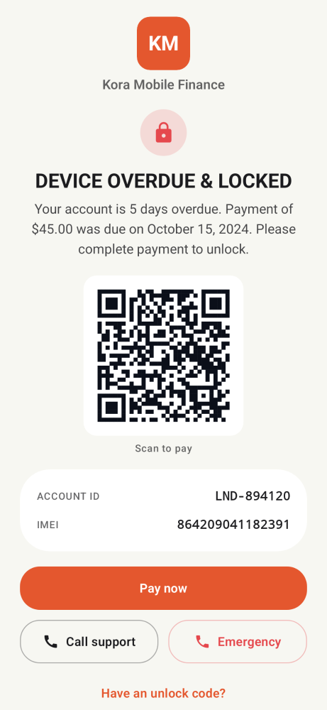

